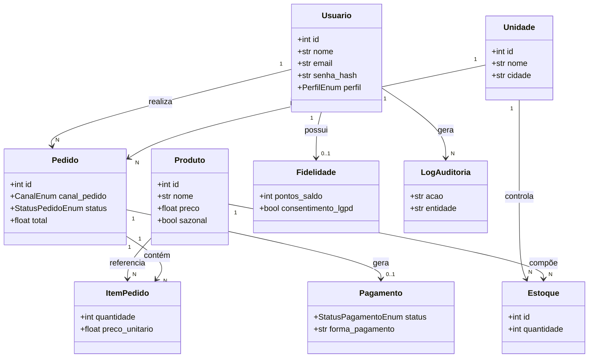
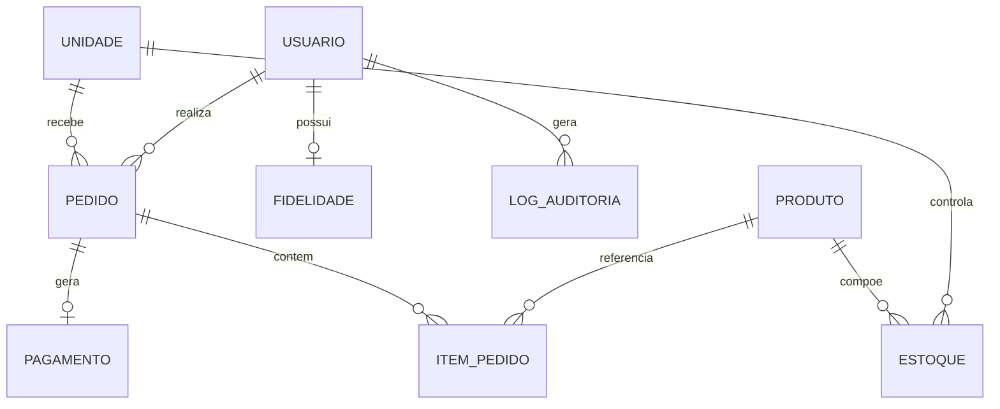

# Análise Técnica — Rede "Raízes do Nordeste" (Trilha Back-End)

> **Como usar este documento**: ele traduz o PDF (`Roteiro Geral` + `Roteiro Trilha Back-End`, UNINTER, 2026) em uma especificação técnica, e depois usa essa especificação para gerar uma **implementação de referência** em `app/`. Todo item é marcado como:
> - **[REQUISITO DO PDF]** — está escrito no documento.
> - **[DECISÃO DE IMPLEMENTAÇÃO]** — decisão técnica necessária para o PDF funcionar, mas não descrita literalmente nele.
> - **[BOA PRÁTICA / SUGESTÃO]** — melhoria que não é cobrada, mas é recomendável.
> - **[INFERÊNCIA]** — interpretação de algo ambíguo/implícito no PDF.
>
> Onde o PDF não especifica algo, isso é dito explicitamente: *"O PDF não especifica isso."*

---

## 1. Resumo do projeto

**[REQUISITO DO PDF]** O sistema deve dar suporte à operação de back-end da rede de lanchonetes "Raízes do Nordeste", uma franquia nordestina em expansão que atende clientes por **múltiplos canais** (aplicativo, totem de autoatendimento, balcão, pickup). O problema que resolve é a **fragmentação operacional**: cada unidade tem estoque e equipe próprios, mas a matriz precisa de padronização, rastreabilidade e consolidação de dados (vendas, produtos mais consumidos, relatórios financeiros, auditoria de operações sensíveis).

Usuários/atores: clientes (pelos canais), atendentes de balcão, cozinha, gerentes/administradores de unidade e a matriz (nível estratégico). Funcionalidades centrais: autenticação com perfis; consulta de cardápio por unidade; criação e acompanhamento de pedidos com canal de origem; controle de estoque por unidade; fidelização com consentimento (LGPD); e solicitação de pagamento a um serviço externo (mock), sem processar pagamento diretamente.

Fluxo geral: cliente consulta cardápio da unidade → cria pedido informando canal → sistema valida itens/estoque → sistema solicita pagamento mock → resultado do pagamento atualiza o pedido → cozinha avança o status até entrega/cancelamento. Em paralelo, o sistema registra pontos de fidelidade (com consentimento) e logs de auditoria para ações sensíveis.

Componentes principais: módulo de autenticação/autorização (JWT + perfis), módulo de catálogo (unidades/produtos/estoque), módulo de pedidos (com canal e status), módulo de pagamento (integração mock desacoplada) e módulo de fidelização/LGPD.

---

## 2. Requisitos Funcionais

| Código | Descrição | Ator | Entrada | Endpoint | Entidade | Regras relacionadas |
|---|---|---|---|---|---|---|
| RF01 | Cadastro e autenticação de usuários, incluindo perfis/roles | Cliente / Administrador | nome, email, senha, perfil | `POST /usuarios`, `POST /auth/login` | Usuario | RN01, RN02 |
| RF02 | Visualização/consulta de cardápio por unidade | Cliente / Atendente | unidadeId | `GET /unidades/{id}/produtos` | Produto, Unidade | RN03 |
| RF03 | Realização de pedidos (itens, valores, status, canal) | Cliente / Atendente | unidadeId, itens[], canalPedido, formaPagamento | `POST /pedidos` | Pedido, ItemPedido | RN04, RN05, RN06 |
| RF04 | Atualização do status do pedido (cozinha → pronto → entregue / cancelado) | Cozinha / Gerente | pedidoId, novoStatus | `PATCH /pedidos/{id}/status` | Pedido | RN07 |
| RF05 | Controle de estoque por unidade (entrada/saída, restrição por indisponibilidade) | Gerente / Sistema | unidadeId, produtoId, quantidade, tipoMovimento | `POST /estoque/movimentacoes`, `GET /estoque` | Estoque | RN04, RN08 |
| RF06 | Programa de fidelização (pontos e resgate simples, com consentimento) | Cliente | clienteId, consentimentoLGPD | `GET /fidelidade/{clienteId}`, `POST /fidelidade/resgate` | Fidelidade | RN09, RN10 |
| RF07 | Promoções/campanhas (documentação da regra de aplicação) | Gerente / Matriz | — | `GET /promocoes` (conceitual) | Promocao | RN11 |
| RF08 | Solicitação de pagamento via serviço externo (mock) + registro do resultado | Cliente / Sistema | pedidoId, valor, formaPagamento | `POST /pagamentos/{pedidoId}/simular` | Pagamento | RN06, RN12 |
| RF09 (multicanalidade) | Registrar e permitir filtrar pedidos por `canalPedido` | Cliente / Atendente / Gerente | canalPedido no corpo do pedido; query param na listagem | `POST /pedidos`, `GET /pedidos?canalPedido=` | Pedido | RN04 |

Exemplo detalhado (RF03):

```
RF03
Descrição: O sistema deve permitir a criação de pedidos com itens, canal de origem e forma de pagamento.
Ator: Cliente (App/Totem/Web) ou Atendente (Balcão)
Entrada: unidadeId, itens (produtoId + quantidade), canalPedido, formaPagamento
Processamento: validação de existência de unidade/produtos, validação de estoque, cálculo do total, persistência do pedido com status inicial AGUARDANDO_PAGAMENTO
Saída: pedido criado com id, total e status
Endpoint: POST /pedidos
Entidade: Pedido, ItemPedido
Regras relacionadas: RN04 (canal obrigatório), RN05 (estoque suficiente), RN06 (fluxo de status)
```

Não foram identificadas funcionalidades adicionais além das listadas acima como sugestão própria de escopo — as poucas decisões de detalhe (ex.: endpoint de resgate de pontos) são **[DECISÃO DE IMPLEMENTAÇÃO]**, pois o PDF exige "pontos e resgate simples" mas não descreve o contrato do endpoint.

---

## 3. Requisitos Não Funcionais

| Código | Descrição | Classificação |
|---|---|---|
| RNF01 | Segurança: LGPD, controle de acesso, senha com hash, token (JWT) | Segurança |
| RNF02 | Logs/auditoria de ações sensíveis (cancelamentos, descontos, ajustes, mudança de status) | Segurança / Confiabilidade |
| RNF03 | Desempenho em horários de pico | Desempenho |
| RNF04 | Disponibilidade e tolerância a falhas na integração de pagamento | Disponibilidade / Confiabilidade |
| RNF05 | Documentação via OpenAPI/Swagger | Documentação |

Para cada um:

1. **RNF01 — Segurança/LGPD**
   - O que o PDF exige: hashing de senha, autenticação por token, autorização por perfil, consentimento explícito para dados pessoais.
   - Como implementar: `passlib[bcrypt]` para hash; `python-jose` para JWT; dependência FastAPI `get_current_user` + verificação de `perfil`; campo `consentimento_lgpd` na entidade Fidelidade.
   - Onde na API: `app/core/security.py`, dependências em `app/routers/*`.
   - Como verificar: tentar acessar endpoint protegido sem token → `401`; com perfil errado → `403`; senha nunca retorna em nenhum response.

2. **RNF02 — Logs/auditoria**
   - Exige: registro de ações sensíveis.
   - Implementação: tabela `LogAuditoria` (usuário, ação, entidade, entidade_id, timestamp) gravada nos services de pedido (mudança de status/cancelamento) e estoque (ajustes).
   - Onde: `app/services/pedido_service.py`, `app/services/estoque_service.py`.
   - Verificação: após uma mudança de status, `GET` (não exposto publicamente nesta referência, mas presente na tabela) mostra novo registro — ver teste `test_log_auditoria_criado`.

3. **RNF03 — Desempenho em pico**
   - O PDF não detalha métricas numéricas (SLA, RPS). **"O PDF não especifica isso."**
   - **[BOA PRÁTICA / SUGESTÃO]**: paginação nas listagens, índices em `pedido.unidade_id`, `pedido.canal_pedido`, `estoque.produto_id/unidade_id`; uso de conexões assíncronas com pool.
   - Onde: paginação em `GET /produtos`, `GET /pedidos`.
   - Verificação: inspeção do plano de índices do banco / testes de carga (fora do escopo desta entrega mínima).

4. **RNF04 — Disponibilidade/tolerância a falhas de pagamento**
   - Exige: sistema não deve depender do processamento real, deve tratar falha do provedor.
   - Implementação: `PagamentoGatewayMock` isolado em `app/services/pagamento_mock.py`, com tratamento de exceção e status `PAGAMENTO_RECUSADO` sem quebrar a API.
   - Verificação: cenário de teste com pagamento "recusado" (ver `test_pagamento_recusado`).

5. **RNF05 — Documentação**
   - FastAPI gera Swagger/OpenAPI automaticamente em `/docs` e `/redoc`.
   - Verificação: acessar `/docs` após subir a API.

---

## 4. Regras de Negócio

| Código | Descrição | Entidade | Endpoint | Implementação |
|---|---|---|---|---|
| RN01 | Um usuário não pode ter dois e-mails iguais | Usuario | `POST /usuarios` | `UNIQUE` no banco + validação no Service |
| RN02 | Senha nunca é armazenada em texto puro | Usuario | `POST /usuarios` | hash bcrypt no Service |
| RN03 | Produto só aparece no cardápio se disponível na unidade consultada | Produto/Estoque | `GET /unidades/{id}/produtos` | filtro no Repository |
| RN04 | Pedido deve informar `canalPedido` válido (APP, TOTEM, BALCAO, PICKUP, WEB) | Pedido | `POST /pedidos` | validação de Enum no Schema (Pydantic) |
| RN05 | Pedido não pode ser criado se algum item não tiver estoque suficiente na unidade | Pedido/Estoque | `POST /pedidos` | validação no Service → erro 409 |
| RN06 | Pedido segue máquina de estados: `AGUARDANDO_PAGAMENTO → EM_PREPARO → PRONTO → ENTREGUE`, ou `CANCELADO` a qualquer momento antes de `ENTREGUE` | Pedido | `PATCH /pedidos/{id}/status` | validação de transição no Service |
| RN07 | Pagamento recusado mantém pedido em `PAGAMENTO_RECUSADO`, não avança para preparo | Pedido/Pagamento | `POST /pagamentos/{pedidoId}/simular` | Service de pagamento |
| RN08 | Estoque não pode ficar negativo | Estoque | `POST /estoque/movimentacoes` | validação no Service → erro 409 |
| RN09 | Pontos de fidelidade só são computados com `consentimentoLgpd = true` | Fidelidade | `POST /pagamentos/{pedidoId}/simular` (side effect) | validação no Service de fidelidade |
| RN10 | Resgate de pontos não pode exceder o saldo | Fidelidade | `POST /fidelidade/resgate` | validação no Service |
| RN11 | Promoções aplicam desconto percentual documentado; aplicação real é **[DECISÃO DE IMPLEMENTAÇÃO]** fora do MVP mínimo | Promocao | — | não implementado no MVP (ver Checklist) |
| RN12 | Toda tentativa de pagamento gera um registro (aprovado ou recusado), nunca é descartada | Pagamento | `POST /pagamentos/{pedidoId}/simular` | persistência sempre no Service |

Exemplo (RN05):
```
RN05 — Um pedido não pode ser criado se algum item não tiver estoque suficiente na unidade.
Entidade: Estoque
Implementação: verificação de quantidade disponível no PedidoService antes do commit; se insuficiente, lança EstoqueInsuficienteError (HTTP 409)
Endpoint: POST /pedidos
```

---

## 5. Atores

| Ator | Função | Responsabilidades | Funcionalidades disponíveis |
|---|---|---|---|
| Cliente | Consumidor final (App/Totem/Web/Pickup) | Ver cardápio, pedir, acompanhar status, acumular/resgatar pontos | RF02, RF03, RF06, RF08 |
| Atendente (Balcão) | Registra pedidos presenciais | Criar pedidos, consultar cardápio | RF02, RF03 |
| Cozinha | Prepara os pedidos | Atualizar status do pedido | RF04 |
| Gerente/Administrador de unidade | Gestão local | Gerir estoque, ver relatórios da unidade, aplicar promoções | RF05, RF07, RF04 |
| Matriz (nível estratégico) | Consolidação e auditoria | Consultar dados consolidados, auditoria de operações sensíveis | RF05 (leitura consolidada), RNF02 |
| Sistema Externo de Pagamento (Gateway) | Ator não-humano | Confirma/nega pagamento | RF08 |

Relação **ATOR → FUNCIONALIDADE → REQUISITO → ENDPOINT**:

- Cliente → Consultar cardápio → RF02 → `GET /unidades/{id}/produtos`
- Cliente → Criar pedido → RF03 → `POST /pedidos`
- Cliente → Consultar pontos → RF06 → `GET /fidelidade/{clienteId}`
- Atendente → Criar pedido (canal BALCAO) → RF03 → `POST /pedidos`
- Cozinha → Atualizar status → RF04 → `PATCH /pedidos/{id}/status`
- Gerente → Movimentar estoque → RF05 → `POST /estoque/movimentacoes`
- Sistema de Pagamento → Confirmar/negar → RF08 → `POST /pagamentos/{pedidoId}/simular`

---

## 6. Casos de Uso

**UC01 — Realizar Pedido**
- Ator: Cliente / Atendente
- Objetivo: registrar um novo pedido com itens e canal
- Pré-condições: unidade e produtos existentes; usuário autenticado
- Fluxo principal: (1) cliente informa unidade, itens e canal; (2) sistema valida existência de produtos; (3) sistema valida estoque; (4) sistema calcula total; (5) sistema persiste pedido com status `AGUARDANDO_PAGAMENTO`
- Fluxos alternativos: item indisponível → sistema sugere remover item (não implementado, fora do MVP)
- Exceções: produto/unidade inexistente → 404; estoque insuficiente → 409; canal ausente/inválido → 422
- Requisito: RF03 / Endpoint: `POST /pedidos`

**UC02 — Solicitar Pagamento (mock)**
- Ator: Cliente / Sistema Externo
- Objetivo: solicitar confirmação de pagamento de um pedido
- Pré-condições: pedido em `AGUARDANDO_PAGAMENTO`
- Fluxo principal: (1) sistema envia solicitação ao gateway mock; (2) gateway retorna aprovado/negado; (3) sistema registra o resultado; (4) sistema atualiza status do pedido
- Exceções: gateway indisponível (simulado) → pedido permanece `AGUARDANDO_PAGAMENTO`, erro 503 tratado
- Requisito: RF08 / Endpoint: `POST /pagamentos/{pedidoId}/simular`

**UC03 — Atualizar Status do Pedido**
- Ator: Cozinha / Gerente
- Objetivo: avançar o pedido no fluxo operacional
- Pré-condições: pedido pago (`EM_PREPARO` em diante) ou cancelamento a qualquer momento anterior à entrega
- Fluxo principal: (1) ator autenticado com perfil adequado; (2) informa novo status; (3) sistema valida transição permitida; (4) sistema persiste e grava log de auditoria
- Exceções: transição inválida → 409; sem permissão → 403
- Requisito: RF04 / Endpoint: `PATCH /pedidos/{id}/status`

**UC04 — Movimentar Estoque**
- Ator: Gerente
- Objetivo: registrar entrada/saída de produto no estoque de uma unidade
- Pré-condições: usuário com perfil GERENTE/ADMIN
- Fluxo principal: (1) informa produto, unidade, quantidade e tipo; (2) sistema valida saldo (para saída); (3) sistema atualiza saldo; (4) grava log de auditoria
- Exceções: saldo insuficiente para saída → 409
- Requisito: RF05 / Endpoint: `POST /estoque/movimentacoes`

**UC05 — Consultar Cardápio por Unidade**
- Ator: Cliente / Atendente
- Objetivo: listar produtos disponíveis em uma unidade específica
- Pré-condições: unidade existente
- Fluxo principal: (1) informa `unidadeId`; (2) sistema retorna produtos com estoque > 0
- Requisito: RF02 / Endpoint: `GET /unidades/{id}/produtos`

---

## 7. Entidades do Sistema

```
Entidade: Usuario
Atributos: id, nome, email, senha_hash, perfil (CLIENTE|ATENDENTE|COZINHA|GERENTE|ADMIN), criado_em
Responsabilidades: autenticação, autorização por perfil
Regras: RN01, RN02
Relacionamentos: Usuario 1:N Pedido (como cliente); Usuario 1:N LogAuditoria (como autor)

Entidade: Unidade
Atributos: id, nome, cidade, regiao, tipo_cozinha (COMPLETA|REDUZIDA)
Responsabilidades: representar uma loja física da rede
Regras: —
Relacionamentos: Unidade 1:N Estoque; Unidade 1:N Pedido

Entidade: Produto
Atributos: id, nome, descricao, preco, categoria, sazonal (bool)
Responsabilidades: item vendável do cardápio
Regras: RN03
Relacionamentos: Produto 1:N Estoque; Produto 1:N ItemPedido

Entidade: Estoque
Atributos: id, unidade_id (FK), produto_id (FK), quantidade
Responsabilidades: saldo de um produto em uma unidade
Regras: RN08
Relacionamentos: N:1 Unidade; N:1 Produto

Entidade: Pedido
Atributos: id, unidade_id (FK), cliente_id (FK), canal_pedido (ENUM), status (ENUM), total, criado_em
Responsabilidades: representar um pedido do cliente
Regras: RN04, RN05, RN06
Relacionamentos: Pedido 1:N ItemPedido; Pedido 1:1 Pagamento (0..1); N:1 Unidade; N:1 Usuario(cliente)

Entidade: ItemPedido
Atributos: id, pedido_id (FK), produto_id (FK), quantidade, preco_unitario
Responsabilidades: linha de um pedido
Relacionamentos: N:1 Pedido; N:1 Produto

Entidade: Pagamento
Atributos: id, pedido_id (FK), status (APROVADO|RECUSADO), forma_pagamento, payload_resposta, criado_em
Responsabilidades: registrar o resultado do gateway externo (mock)
Regras: RN07, RN12
Relacionamentos: 1:1 Pedido

Entidade: Fidelidade
Atributos: id, cliente_id (FK), pontos_saldo, consentimento_lgpd (bool)
Responsabilidades: saldo de pontos por cliente
Regras: RN09, RN10
Relacionamentos: 1:1 Usuario(cliente)

Entidade: LogAuditoria [DECISÃO DE IMPLEMENTAÇÃO]
Atributos: id, usuario_id (FK), acao, entidade, entidade_id, detalhes, criado_em
Responsabilidades: rastreabilidade de ações sensíveis (RNF02)
Relacionamentos: N:1 Usuario

Entidade: Promocao [DECISÃO DE IMPLEMENTAÇÃO — modelada, não aplicada no MVP]
Atributos: id, descricao, percentual_desconto, ativa
Responsabilidades: representar campanhas (RF07), aplicação de fato fica fora do MVP
```

---

## 8. Relacionamentos (resumo)

- `Usuario (1) --- (N) Pedido`
- `Usuario (1) --- (0..1) Fidelidade`
- `Unidade (1) --- (N) Estoque`
- `Unidade (1) --- (N) Pedido`
- `Produto (1) --- (N) Estoque`
- `Produto (1) --- (N) ItemPedido`
- `Pedido (1) --- (N) ItemPedido`
- `Pedido (1) --- (0..1) Pagamento`
- `Usuario (1) --- (N) LogAuditoria`

---

## 9. Diagrama de Classes

Representação textual:

```
Usuario
--------------------------------
- id: int
- nome: str
- email: str
- senha_hash: str
- perfil: PerfilEnum
--------------------------------
+ autenticar()
+ criar()

        1
        |
        | realiza
        |
        N

Pedido
--------------------------------
- id: int
- unidade_id: int
- cliente_id: int
- canal_pedido: CanalEnum
- status: StatusPedidoEnum
- total: float
--------------------------------
+ criar()
+ atualizar_status()
+ cancelar()

        1
        |
        | possui
        |
        N

ItemPedido
--------------------------------
- id: int
- pedido_id: int
- produto_id: int
- quantidade: int
- preco_unitario: float

Pedido (1) --- (0..1) Pagamento
Unidade (1) --- (N) Estoque --- (N) Produto
Usuario (1) --- (0..1) Fidelidade
```

Versão em Mermaid:



---

## 10. Modelo de Banco de Dados

| Tabela | Campo | Tipo | PK | FK | Obrigatório | Restrição |
|---|---|---|---|---|---|---|
| usuarios | id | INTEGER | ✔ | | ✔ | AUTOINCREMENT |
| usuarios | nome | VARCHAR(120) | | | ✔ | |
| usuarios | email | VARCHAR(160) | | | ✔ | UNIQUE |
| usuarios | senha_hash | VARCHAR(255) | | | ✔ | |
| usuarios | perfil | VARCHAR(20) | | | ✔ | CHECK IN (CLIENTE,ATENDENTE,COZINHA,GERENTE,ADMIN) |
| unidades | id | INTEGER | ✔ | | ✔ | |
| unidades | nome | VARCHAR(120) | | | ✔ | |
| unidades | cidade | VARCHAR(80) | | | ✔ | |
| unidades | tipo_cozinha | VARCHAR(20) | | | ✔ | |
| produtos | id | INTEGER | ✔ | | ✔ | |
| produtos | nome | VARCHAR(120) | | | ✔ | |
| produtos | preco | NUMERIC(10,2) | | | ✔ | > 0 |
| produtos | sazonal | BOOLEAN | | | ✔ | default false |
| estoques | id | INTEGER | ✔ | | ✔ | |
| estoques | unidade_id | INTEGER | | ✔ (unidades.id) | ✔ | |
| estoques | produto_id | INTEGER | | ✔ (produtos.id) | ✔ | UNIQUE(unidade_id, produto_id) |
| estoques | quantidade | INTEGER | | | ✔ | >= 0 |
| pedidos | id | INTEGER | ✔ | | ✔ | |
| pedidos | unidade_id | INTEGER | | ✔ (unidades.id) | ✔ | |
| pedidos | cliente_id | INTEGER | | ✔ (usuarios.id) | ✔ | |
| pedidos | canal_pedido | VARCHAR(10) | | | ✔ | CHECK IN (APP,TOTEM,BALCAO,PICKUP,WEB) |
| pedidos | status | VARCHAR(25) | | | ✔ | CHECK IN (AGUARDANDO_PAGAMENTO,PAGAMENTO_RECUSADO,EM_PREPARO,PRONTO,ENTREGUE,CANCELADO) |
| pedidos | total | NUMERIC(10,2) | | | ✔ | >= 0 |
| itens_pedido | id | INTEGER | ✔ | | ✔ | |
| itens_pedido | pedido_id | INTEGER | | ✔ (pedidos.id) | ✔ | |
| itens_pedido | produto_id | INTEGER | | ✔ (produtos.id) | ✔ | |
| itens_pedido | quantidade | INTEGER | | | ✔ | > 0 |
| itens_pedido | preco_unitario | NUMERIC(10,2) | | | ✔ | |
| pagamentos | id | INTEGER | ✔ | | ✔ | |
| pagamentos | pedido_id | INTEGER | | ✔ (pedidos.id) | ✔ | UNIQUE |
| pagamentos | status | VARCHAR(15) | | | ✔ | CHECK IN (APROVADO,RECUSADO) |
| pagamentos | forma_pagamento | VARCHAR(20) | | | ✔ | |
| fidelidades | id | INTEGER | ✔ | | ✔ | |
| fidelidades | cliente_id | INTEGER | | ✔ (usuarios.id) | ✔ | UNIQUE |
| fidelidades | pontos_saldo | INTEGER | | | ✔ | >= 0 |
| fidelidades | consentimento_lgpd | BOOLEAN | | | ✔ | default false |
| logs_auditoria | id | INTEGER | ✔ | | ✔ | |
| logs_auditoria | usuario_id | INTEGER | | ✔ (usuarios.id) | | pode ser nulo (ação de sistema) |
| logs_auditoria | acao | VARCHAR(60) | | | ✔ | |
| logs_auditoria | entidade | VARCHAR(60) | | | ✔ | |
| logs_auditoria | entidade_id | INTEGER | | | ✔ | |

Representação textual:

```
USUARIO
   |
   | 1:N
   ↓
PEDIDO ---1:N--- ITEM_PEDIDO ---N:1--- PRODUTO
   |
   | 1:0..1
   ↓
PAGAMENTO

UNIDADE --1:N--- ESTOQUE ---N:1--- PRODUTO
UNIDADE --1:N--- PEDIDO
USUARIO --1:0..1--- FIDELIDADE
USUARIO --1:N--- LOG_AUDITORIA
```

Mermaid (ER):



---

## 11. Arquitetura da API

**[REQUISITO DO PDF]** Python + FastAPI (documentação automática, OpenAPI, Swagger, tipagem). **[REQUISITO DO PDF]** organização em camadas Domain / Application / Infrastructure / API (ou equivalente), com separação clara de responsabilidades.

Estrutura adotada (equivalente à sugerida no PDF, adaptada com `repositories` explícitos para clareza didática):

```
raizes-nordeste-api/
├── app/
│   ├── main.py                # bootstrap FastAPI, inclui routers e exception handlers
│   ├── core/
│   │   ├── config.py          # settings (env vars)
│   │   └── security.py        # hash de senha, JWT, dependências de auth
│   ├── database/
│   │   └── connection.py      # engine/session SQLAlchemy
│   ├── models/                # Domain: entidades SQLAlchemy
│   ├── schemas/                # contratos Pydantic (request/response)
│   ├── repositories/          # Infrastructure: acesso a dados
│   ├── services/              # Application: regras de negócio/casos de uso
│   ├── routers/                # API: endpoints FastAPI
│   ├── exceptions/            # exceções de domínio + handlers HTTP
│   └── tests/                  # pytest
├── requirements.txt
├── .env.example
└── README.md
```

Mapeamento para as camadas do PDF: `models` = Domain; `services` = Application; `repositories` + `database` = Infrastructure; `routers` + `schemas` = API/Interface.

---

## 12. Matriz de Rastreabilidade

| Requisito | Regra | Entidade | Endpoint | Service | Teste |
|---|---|---|---|---|---|
| RF01 | RN01, RN02 | Usuario | `POST /usuarios`, `POST /auth/login` | `UsuarioService` | `test_criar_usuario`, `test_login_valido` |
| RF02 | RN03 | Produto/Estoque | `GET /unidades/{id}/produtos` | `CatalogoService` | `test_listar_cardapio_unidade` |
| RF03 / RF09 | RN04, RN05 | Pedido | `POST /pedidos`, `GET /pedidos` | `PedidoService` | `test_criar_pedido_valido`, `test_pedido_sem_canal`, `test_pedido_estoque_insuficiente`, `test_filtrar_pedidos_por_canal` |
| RF04 | RN06 | Pedido | `PATCH /pedidos/{id}/status` | `PedidoService` | `test_atualizar_status_pedido`, `test_transicao_status_invalida` |
| RF05 | RN08 | Estoque | `POST /estoque/movimentacoes` | `EstoqueService` | `test_movimentar_estoque`, `test_estoque_saida_insuficiente` |
| RF06 | RN09, RN10 | Fidelidade | `GET /fidelidade/{clienteId}`, `POST /fidelidade/resgate` | `FidelidadeService` | `test_pontos_sem_consentimento`, `test_resgate_pontos` |
| RF08 | RN06, RN07, RN12 | Pagamento | `POST /pagamentos/{pedidoId}/simular` | `PagamentoService` | `test_pagamento_aprovado`, `test_pagamento_recusado` |

---

## 13. Lista completa de endpoints

| Método | Endpoint | Requisito | Descrição | Autenticação |
|---|---|---|---|---|
| POST | /auth/login | RF01 | Autentica e retorna JWT | Pública |
| POST | /usuarios | RF01 | Cadastra usuário/cliente | Pública |
| GET | /unidades | RF02 | Lista unidades | Pública |
| GET | /unidades/{id}/produtos | RF02 | Cardápio disponível na unidade | Pública |
| POST | /produtos | [DECISÃO] | Cadastra produto (catálogo global) | JWT (GERENTE/ADMIN) |
| POST | /estoque/movimentacoes | RF05 | Registra entrada/saída de estoque | JWT (GERENTE/ADMIN) |
| GET | /estoque | RF05 | Consulta saldo por unidade/produto | JWT (GERENTE/ADMIN/COZINHA) |
| POST | /pedidos | RF03 / RF09 | Cria pedido | JWT (CLIENTE/ATENDENTE) |
| GET | /pedidos | RF03 / RF09 | Lista/filtra pedidos (`?canalPedido=`) | JWT |
| GET | /pedidos/{id} | RF03 | Consulta um pedido | JWT |
| PATCH | /pedidos/{id}/status | RF04 | Atualiza status do pedido | JWT (COZINHA/GERENTE) |
| POST | /pagamentos/{pedidoId}/simular | RF08 | Simula pagamento (mock) e atualiza pedido | JWT |
| GET | /fidelidade/{clienteId} | RF06 | Consulta saldo de pontos | JWT (próprio cliente/GERENTE) |
| POST | /fidelidade/resgate | RF06 | Resgata pontos | JWT (CLIENTE) |

Documentação individual por endpoint (modelo completo, request/response, status codes) está em `/docs` (Swagger, gerado automaticamente) e reproduzida no arquivo `postman_collection.json`. Exemplo (o mais crítico):

```
POST /pedidos
Objetivo: criar um pedido validando estoque e canal.
Requisito atendido: RF03, RF09
Regra de negócio: RN04, RN05

Request:
{
  "unidadeId": 1,
  "canalPedido": "TOTEM",
  "itens": [{"produtoId": 1, "quantidade": 2}],
  "formaPagamento": "PIX"
}

Response (201):
{
  "id": 1,
  "status": "AGUARDANDO_PAGAMENTO",
  "total": 25.80,
  "canalPedido": "TOTEM",
  "itens": [{"produtoId": 1, "quantidade": 2, "precoUnitario": 12.90}]
}

Status HTTP: 201, 400, 401, 404, 409, 422
Validações: canalPedido no Enum; itens não vazio; produto/unidade existentes
Possíveis erros: 404 (unidade/produto inexistente), 409 (estoque insuficiente), 422 (payload inválido)
```

---

## 15. Documentação (instalação, execução, testes)

Ver `README.md` na raiz do projeto — cobre instalação, configuração, execução, migrations (via `Base.metadata.create_all` para SQLite no MVP — **[DECISÃO DE IMPLEMENTAÇÃO]**, o PDF menciona migrations "quando necessárias"), testes, Swagger/OpenAPI e autenticação.

---

## 16. Validações e Tratamento de Erros

```
Schema (Pydantic)         → formato/tipo (ex.: canalPedido precisa ser um dos valores do Enum) → 422
Service (regra de negócio)→ RN04, RN05, RN06, RN08, RN09, RN10                                  → 409 / 400
Database (integridade)     → UNIQUE(email), UNIQUE(unidade_id, produto_id), FKs                  → 409 (tratado) 
Router (recurso)           → existência de unidade/produto/pedido                                → 404
Auth                       → token ausente/expirado → 401; perfil sem permissão → 403
```

Formato de erro padronizado (usado em todos os handlers, `app/exceptions/handlers.py`):

```json
{
  "error": "ESTOQUE_INSUFICIENTE",
  "message": "Não há quantidade suficiente para um ou mais itens.",
  "details": [{"field": "itens[0].quantidade", "issue": "Disponível: 1"}],
  "timestamp": "2026-09-09T12:00:00Z",
  "path": "/pedidos"
}
```

---

## 17. Segurança

**[REQUISITO DO PDF]**: LGPD (finalidade, minimização, consentimento), hashing de senha, JWT, autorização por perfil.
**[BOA PRÁTICA / SUGESTÃO]** (não exigida explicitamente, mas comum em produção): CORS restritivo, variáveis de ambiente (`.env`), rate limiting, refresh token — este último **não** foi implementado no MVP para manter o escopo enxuto (ver Checklist/Otimização).

Implementado nesta referência:
- Hash de senha com bcrypt (`passlib`).
- JWT com expiração (`python-jose`), claim `perfil`.
- Dependência `require_roles(...)` para autorização por perfil em cada router.
- Nenhum endpoint retorna `senha_hash`.
- Consentimento LGPD como campo explícito (`consentimento_lgpd`) exigido antes de conceder pontos.
- Variáveis sensíveis (chave JWT, URL do banco) via `.env` / `app/core/config.py`.

---

## 18. Testes

```
RF01
├── test_criar_usuario (válido)
├── test_criar_usuario_email_duplicado (RN01)
└── test_login_valido / test_login_invalido

RF03/RF09
├── test_criar_pedido_valido
├── test_pedido_sem_canal (422)
├── test_pedido_estoque_insuficiente (409)
└── test_filtrar_pedidos_por_canal

RF04
├── test_atualizar_status_pedido
└── test_transicao_status_invalida (409)

RF05
├── test_movimentar_estoque
└── test_estoque_saida_insuficiente (409)

RF08
├── test_pagamento_aprovado
└── test_pagamento_recusado

Autenticação/Autorização
├── test_acesso_sem_token (401)
└── test_acesso_sem_permissao (403)
```

Implementados via `pytest` + `TestClient` do FastAPI, banco SQLite em memória por teste (`app/tests/conftest.py`).

---

## 19. README

Ver arquivo `README.md` — contém todos os 20 itens solicitados (nome, descrição, objetivo, tecnologias, arquitetura, estrutura de pastas, requisitos, instalação, configuração, banco, variáveis de ambiente, execução, testes, Swagger, OpenAPI, endpoints, autenticação, decisões arquiteturais, limitações, melhorias futuras).

---

## 20. Conclusão do Projeto

- **Finalidade**: dar suporte de back-end a uma rede de lanchonetes com múltiplos canais de atendimento, padronizando pedidos, estoque e fidelização entre unidades.
- **Problema resolvido**: fragmentação operacional entre unidades e falta de rastreabilidade multicanal, com pagamento desacoplado de um provedor externo.
- **Usuários**: clientes, atendentes, cozinha, gerentes/administradores, matriz e o gateway de pagamento (ator de sistema).
- **RF principais**: autenticação com perfis; cardápio por unidade; pedidos com canal; atualização de status; estoque por unidade; fidelização com consentimento; pagamento mock.
- **RNF principais**: segurança/LGPD, auditoria, desempenho em pico, disponibilidade/tolerância a falhas, documentação OpenAPI.
- **RN principais**: unicidade de e-mail, obrigatoriedade e validade do canal, verificação de estoque antes de confirmar pedido, máquina de estados do pedido, consentimento antes de pontuar.
- **Entidades centrais**: Usuario, Unidade, Produto, Estoque, Pedido, ItemPedido, Pagamento, Fidelidade.
- **Relacionamento entre entidades**: Pedido é o nó central, ligando Usuario (cliente), Unidade, ItemPedido→Produto e (opcionalmente) Pagamento; Estoque liga Unidade e Produto.
- **Como a API resolve o problema**: cada camada isola uma preocupação (regra de negócio em `services`, persistência em `repositories`), o que permite auditar e evoluir o sistema sem acoplar tudo aos endpoints.
- **Pontos críticos**: consistência entre validação de estoque e criação do pedido (condição de corrida em cenário concorrente — não tratada nesta referência, ver Otimização); dependência do resultado do mock de pagamento.
- **Decisões arquiteturais**: camadas Domain/Application/Infrastructure/API; SQLite para simplicidade de execução local (**[DECISÃO DE IMPLEMENTAÇÃO]**, PDF não define o SGBD); pagamento mock isolado em serviço próprio.
- **Limitações**: sem tratamento de concorrência (lock otimista/pessimista) no débito de estoque; sem refresh token; promoções modeladas mas não aplicadas automaticamente; sem consolidação analítica (dashboards) para a matriz.
- **Melhorias futuras**: fila assíncrona para o pagamento (webhook em vez de chamada síncrona simulada); cache do cardápio; relatórios consolidados; testes de carga para RNF03.

---

## 21. Checklist Final

**Requisitos funcionais**
- [x] RF01 — Cadastro/autenticação
- [x] RF02 — Cardápio por unidade
- [x] RF03 — Criação de pedido
- [x] RF04 — Atualização de status
- [x] RF05 — Controle de estoque
- [x] RF06 — Fidelização
- [ ] RF07 — Promoções (modelado, aplicação **fora do MVP**)
- [x] RF08 — Pagamento mock
- [x] RF09 — Multicanalidade (filtro por canal)

**Requisitos não funcionais**
- [x] RNF01 — Segurança/LGPD (hash, JWT, perfis, consentimento)
- [x] RNF02 — Logs de auditoria
- [ ] RNF03 — Desempenho em pico (apenas boas práticas, sem teste de carga)
- [x] RNF04 — Tratamento de falha do pagamento mock
- [x] RNF05 — Documentação OpenAPI/Swagger

**Regras de negócio**: RN01–RN10 implementadas; RN11 (promoção) modelada sem aplicação automática; RN12 implementada.

**Entidades**: Usuario, Unidade, Produto, Estoque, Pedido, ItemPedido, Pagamento, Fidelidade, LogAuditoria — todas presentes no banco.

**Banco**: tabelas e relacionamentos conforme seção 10.

**API**: todos os endpoints da seção 13 implementados e documentados no Swagger.

**Segurança**: JWT, hash, perfis, consentimento — implementados. Rate limiting/CORS restritivo — não implementados (fora do escopo mínimo).

**Testes**: cenários da seção 18 implementados em `app/tests/`.

**Documentação**: este arquivo + `README.md` + Swagger automático.

---

## 22. Análise de Otimização

**OBRIGATÓRIO (para cumprir o PDF)**
- Persistência real (não em memória) — feito com SQLAlchemy/SQLite.
- Autenticação JWT + 1 regra de autorização — feito.
- Fluxo crítico fechado ponta a ponta (pedido → pagamento mock → status) — feito.
- Uso do campo `canalPedido` na criação e no filtro — feito.
- Padrão de erro consistente — feito.
- Swagger refletindo os endpoints reais — feito (automático).

**RECOMENDADO (qualidade/organização/segurança/manutenção)**
- Tratamento de concorrência no débito de estoque (ex.: `SELECT ... FOR UPDATE` ou versionamento otimista) para evitar overselling em pico de pedidos simultâneos.
- Paginação padronizada em todas as listagens (`page`, `limit`) — parcialmente aplicada; recomenda-se estender a `/pedidos` e `/estoque`.
- CORS restrito por ambiente e rate limiting básico.
- Logs estruturados (JSON) para facilitar observabilidade em produção.
- Separar banco de testes do banco de desenvolvimento (já feito via SQLite em memória, mas vale formalizar com Alembic para migrations versionadas em vez de `create_all`).

**OPCIONAL (avançado, não necessário para o escopo do PDF)**
- Migração para PostgreSQL + Alembic para migrations versionadas.
- Fila de mensageria (ex.: RabbitMQ) para desacoplar a confirmação de pagamento via webhook assíncrono, em vez de chamada síncrona ao mock.
- Cache (Redis) para o cardápio por unidade, reduzindo carga em horário de pico (RNF03).
- Observabilidade completa (tracing distribuído, métricas Prometheus).
- Multi-tenancy mais explícito por unidade (schemas separados) caso a escala justifique.
